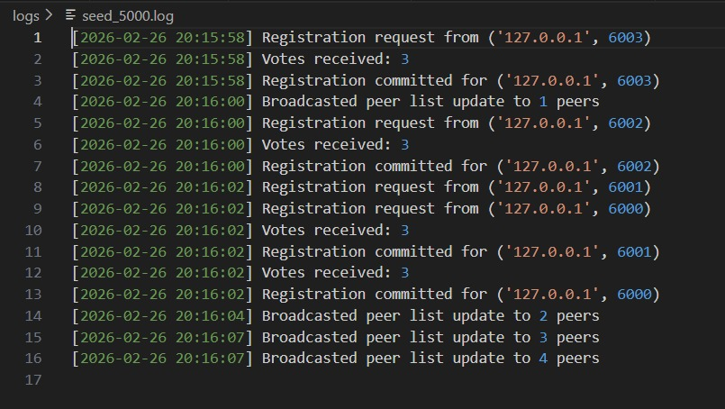
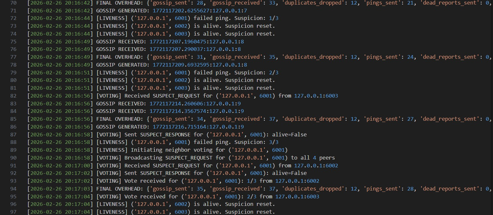
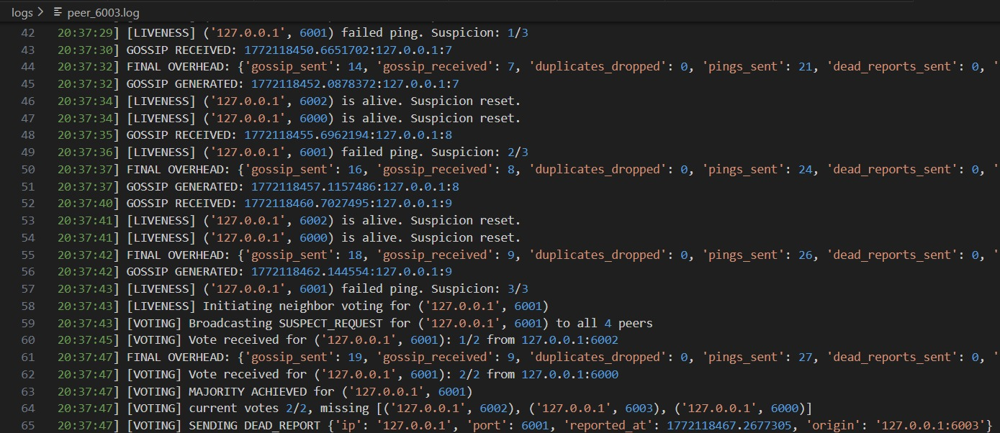
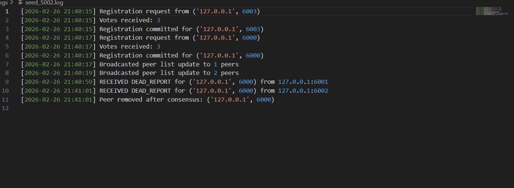

# CSL3080 – Assignment 1  
## Gossip-Based P2P Network with Two-Level Consensus

---

## Authors

- Aurindum Banerjee – B23CS1006  
- Lokesh Motwani – B23CS1033  

---

## Overview

This project implements a gossip-based peer-to-peer (P2P) network with:

- Majority-based seed consensus for membership
- Preferential-attachment (power-law) overlay construction
- Reliable gossip dissemination
- Two-level failure detection consensus
- TCP-based liveness checking
- Dynamic membership updates
- Overhead tracking and structured logging

The system consists of:

- **Seed Nodes** – Membership management and consensus  
- **Peer Nodes** – Gossip dissemination and liveness monitoring  

All communication uses TCP sockets with JSON-encoded messages.

---

# System Architecture

## Seed Nodes

- Maintain global `peer_list`
- Perform majority-based registration
- Perform majority-based removal
- Broadcast `PEER_LIST_UPDATE` on membership change

Consensus rule:

```
Majority = floor(n / 2) + 1
```

---

## Peer Nodes

Startup sequence:

1. Read seeds from `config.txt`
2. Register with majority of seeds
3. Merge received peer lists
4. Build overlay using preferential attachment
5. Start:
   - TCP server thread
   - Gossip generator thread
   - Liveness checker thread

---

# Gossip Protocol

Message format:

```
<timestamp>:<IP>:<MsgNumber>
```

Rules:

- 10 messages per peer
- 5-second interval
- Forward to all neighbors except sender

---

# Liveness Detection

- TCP-based connectivity check every 5 seconds
- 3 consecutive failures trigger suspicion
- Peer-level voting via `SUSPECT_REQUEST`
- Majority confirmation triggers `DEAD_REPORT` to seeds
- Seed-level majority required for final removal

---

# Overhead Tracking

Each peer tracks:

- gossip_sent  
- gossip_received  
- duplicates_dropped  
- pings_sent  
- dead_reports_sent

Logs stored in:

```
logs/peer_<port>.log
logs/seed_<port>.log
```

---

# Directory structure:

```
CSL3080/
│
├── seed.py
├── peer.py
├── config.py
├── utils.py
├── launcher.py
├── config.txt
├── logs/
├── images/
└── README.md
```

---

# Working Images

Images demonstrating working.

## Image1 – Seed Registration and Broadcast

Here, we see registration requests received by seed and majority voting before commit.  
After receiving majority approvals, the seed commits the registration and broadcasts an updated peer list to all active peers.



---

## Image2 - Overlay Construction and Gossip Activity

We see a peer receiving the merged peer list from seeds and constructing its neighbor set using preferential attachment (simulating power law).  
It then generates gossip messages and logs overhead statistics including sent, received, and ping counts.



---

## Image3 – Peer Suspicion and Voting

This image shows repeated TCP ping failures increasing the suspicion counter.
Upon reaching the threshold, the peer broadcasts `SUSPECT_REQUEST`, collects `SUSPECT_RESPONSE` votes from other peers, achieves majority, and sends a structured `DEAD_REPORT` to all seeds.



---

## Image4 – Seed-Level Dead Report Handling

This image shows the seed receiving `DEAD_REPORT` and tracking consensus votes.
After majority agreement among seeds, the dead peer is removed from the global `peer_list`, and an updated peer list is broadcast to the remaining peers to rebuild overlays consistently.



---


# How to Run

Start seeds 

```
python seed.py 5000
python seed.py 5001
python seed.py 5002
```

Start peers 

```
python peer.py 6000
python peer.py 6001
python peer.py 6002
python peer.py 6003
```

Or use launcher

```
python launcher.py 3 4
```


Launcher:
- Checks port availability
- Spawns processes
- Terminates all on Ctrl-C

To kill a port, we can either close the respective terminal or use our python code

```
python kill_single_port.py
>>> input : <desired peer port to kill>
```


---

### Testing Procedure

1. Start seeds.
2. Start peers.
3. Observe:
   - Registration majority
   - Peer list broadcast
   - Overlay formation
   - Gossip propagation
4. Kill a peer. 
5. Observe:
   - Suspicion phase
   - Peer-level voting
   - Dead report
   - Seed consensus
   - Peer-list update broadcast
   - Overlay rebuild

---


# Repository

GitHub Repository:  
[CNAssignment1](https://github.com/AurindumBanerjee/CNAssignment1)